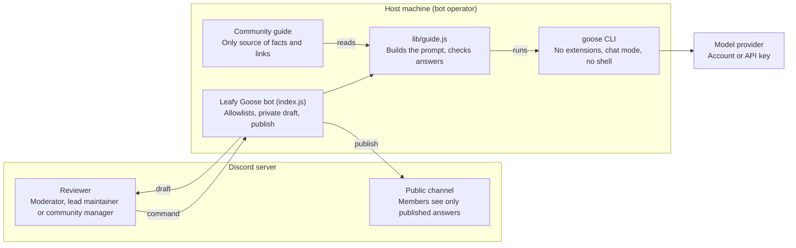

# Leafy Goose Specification

Last updated: October 29, 2026

Leafy Goose is a Discord assistant for the Developer Relations Foundation (DRF) community. It drafts answers with goose, and a DRF moderator, lead maintainer or community manager reviews every draft before anything is posted.

## Goals and non-goals

The bot helps reviewers answer common questions faster, with facts from one approved guide. A human always decides what is posted.

**Goals**

1. Draft short, correct answers to common DRF questions in English.
2. Lead members to one clear next step. During the governance transition this is a **Community Touchpoint** or the **2027 DRF Unconference**.
3. Use only facts, links and public channels from the community guide.
4. Keep a human reviewer in control of every published message.
5. Be safe to publish as open source and easy to adapt to other communities.

**Non-goals**

- It never posts on its own, and it never replies automatically to messages.
- It does not moderate, enforce the Code of Conduct, or decide who is right in a conflict.
- It does not give legal advice or speak for DRF or the Linux Foundation.
- It does not browse the web, run tools, or read files on the host machine.
- It does not read message history. It sees only the one message a reviewer picks.

## Roles

Only reviewers can use the bot. Members only see answers that a reviewer published.

| Role | Who | Can do |
| --- | --- | --- |
| Reviewer | DRF moderators, lead maintainers and community managers listed in `DISCORD_ALLOWED_USER_ID` | Run the commands, read drafts, publish, edit or discard them, reload the guide |
| Member | Everyone else in the server | Ask questions in public channels and read published answers. Cannot run the commands or press the buttons |
| Bot operator | The person who runs the bot on their machine | Holds the Discord token and the goose sign-in. Edits the guide and the settings |

Each published answer names its reviewer in the footer, so members know a person checked it.

## Review flow

A draft goes public only when a reviewer clicks Publish. Drafts expire after 14 minutes, before Discord's 15-minute interaction limit.

1. A member asks a question in a public channel.
2. A reviewer right-clicks the message and picks **Apps → Answer with Leafy Goose**, or types `/leafy question:`.
3. The bot checks that the reviewer is allowed and the channel is allowed. Then it defers the reply, because Discord needs a first response within 3 seconds.
4. The bot sends the guide and the member's text to goose and waits up to 120 seconds.
5. The bot checks the answer and shows an **ephemeral draft** that only the reviewer can see, with any warnings.
6. The reviewer picks one action:
    - **Publish**: the bot replies to the member's message, with link previews off and a disclosure footer.
    - **Edit**: a form opens with the text. The bot checks the edited text again and shows the new draft.
    - **Discard**: the draft is closed and nothing is posted.
7. If goose has no approved answer, it returns `NO_ANSWER`. The bot tells the reviewer to answer by hand or add the facts to the guide.

If the bot cannot post in a channel, it publishes the answer as a public reply to the reviewer's command instead.

Published footer: `AI-assisted answer, reviewed by @reviewer. DRF info checked Oct 27, 2026.`

## Architecture

The bot, goose and the guide run on one host machine. Only the prompt leaves it, and only a reviewer's click puts an answer in a public channel. Discord secrets never reach goose.

## Knowledge and answer rules

The community guide is the bot's only source of facts. Changing what the bot says means editing the guide, not the code.

**The guide** (`skills/drf-community-guide/SKILL.md`, or the file in `GUIDE_PATH`)

- Markdown in the goose skill format: a `name` and `description` block at the top, then the guide. Public information only. The bot may quote anything in it.
- The bot sends the whole guide in every prompt and leaves out the `name` and `description` block. It does not let goose load the guide as a skill, because goose loads a skill only when it decides the question matches, and skills need goose extensions that the bot turns off.
- People can copy the same folder to `~/.agents/skills/` to use the guide in their own goose. A plain Markdown file without the top block also works with the bot.
- Must contain a `Last reviewed: <Month Day, Year>` line. Drafts show a warning when it is older than 30 days.
- Every URL in the guide is an approved link. Every `<#id>` mention is an approved public channel.
- Private channels, meeting passwords and personal data stay out of it.
- After an edit: update the review date, run the evals, then `/leafy-reload`.

**Answer rules** (in the prompt built by `lib/guide.js`)

| Rule | Value |
| --- | --- |
| Language | Always English, whatever language the member uses |
| Length | At most 120 words, short sentences, Discord Markdown |
| Shape | A one-line welcome or direct answer, then one next step |
| Links | At most two, copied from the guide, inside angle brackets |
| Dates | Never a date or time for a future meeting; point to the calendar |
| Style | No em or en dashes; no footer, signature or meta comments |
| Out of scope | One line: `NO_ANSWER: <reason>` |
| Small talk | One friendly line that invites a DRF question |

**Checks on every draft** (`checkAnswer`)

- Links not in the guide, and channels not in the public list, are flagged.
- Phrases that suggest a prompt leak or a wrong "DRF" (for example "Django") are flagged.
- Footer lines from the model are removed, and dashes are replaced.
- Answers longer than 1,500 characters are cut and flagged.

## Security and privacy

The main control is human review: nothing reaches members without a reviewer's click. The other controls limit what the model and the bot can do.

| Risk | Control | Where |
| --- | --- | --- |
| A wrong or harmful answer is posted | Every answer is an ephemeral draft; only a reviewer can publish | `index.js` |
| Strangers use the bot or the model account | Only `DISCORD_ALLOWED_USER_ID` can run commands or press buttons; optional channel allowlist; Integrations settings hide the commands | `index.js`, Discord |
| Prompt injection in a member's message | Text marked as untrusted, limited to 1,500 characters, and every `<` and `>` escaped so it cannot open or close the prompt markers | `lib/guide.js` |
| The agent runs tools on the host | goose runs with `--no-profile` (no extensions), `GOOSE_MODE=chat`, `--max-turns 2`, through `execFile` (no shell) | `lib/guide.js` |
| Secrets reach the model | Every `DISCORD_*` variable is removed from goose's environment | `lib/guide.js` |
| Wrong or malicious links | Unknown links and channels are flagged; link previews are off | `lib/guide.js`, `index.js` |
| Mass mentions | Published messages cannot ping `@everyone`, `@here` or roles; only the member answered is mentioned | `index.js` |
| Private data in logs | Member questions are not logged, and goose errors never repeat the prompt | `index.js`, `lib/guide.js` |
| Secrets in the repository | `.env` and backups are in `.gitignore`; CI fails on tracked `.env` files or token-like strings | `.gitignore`, CI |
| Abuse of the bot's reach | Public Bot off; minimum permissions; no privileged intents | Developer Portal |

**Privacy.** Member text goes to the model provider configured in goose (for example a ChatGPT account). The footer on every published message says the answer is AI-assisted and names the reviewer.

## Configuration

All settings live in `.env`, which is never committed. [`.env.example`](../.env.example) lists them.

| Setting | Required | What it does |
| --- | --- | --- |
| `DISCORD_TOKEN` | Yes | Bot token from the Developer Portal. Secret |
| `DISCORD_CLIENT_ID` | Yes | Application ID |
| `DISCORD_GUILD_ID` | Yes | Server where the commands are registered |
| `DISCORD_ALLOWED_USER_ID` | Yes | Reviewer user IDs, comma-separated |
| `DISCORD_ALLOWED_CHANNEL_IDS` | No | Channels where the bot works, comma-separated. Empty means all |
| `GOOSE_BIN` | No | Path to goose. Default `goose` |
| `GOOSE_MODEL` | No | Model override. Empty uses goose's configured model |
| `GOOSE_TIMEOUT_SECONDS` | No | Time limit for one draft. Default 120 |
| `GUIDE_PATH` | No | Path to the guide. Default `skills/drf-community-guide/SKILL.md` |

**Discord app settings:** Public Bot off; no privileged intents; permissions View Channels, Send Messages, Send Messages in Threads, Read Message History; scopes `bot` and `applications.commands`.

## Operations and testing

The bot runs as one Node.js process on the operator's machine, next to goose. It answers only while that process runs.

| Task | Command |
| --- | --- |
| Install | `npm ci` |
| Run | `npm start` (keep the machine awake while it runs) |
| Unit tests (no Discord, no goose, no network) | `npm test` |
| Real questions through goose | `npm run eval` (add `-- -v` to print every answer) |
| Syntax check | `npm run check` |
| Reload the guide without a restart | `/leafy-reload` in Discord |

**Unit tests** (17) cover guide loading, the skill format of the DRF guide (the top block is never sent to the model), `NO_ANSWER`, link and channel warnings, meta-comment warnings, footer and dash clean-up, length limits, prompt-marker escapes (including nested tags), removal of `DISCORD_*` secrets, goose errors that never repeat the prompt, and the goose safety flags (with a fake goose).

**Evals** (14 questions in `test/eval-questions.json`) check real answers: Touchpoints for newcomers, the Unconference for ideas, no invented dates, no private channels, English for a Spanish question, no Django confusion, and `NO_ANSWER` for off-topic and injection attempts.

**CI** (GitHub Actions) runs the syntax check and unit tests on every push and pull request, with read-only permissions, and fails if a `.env` file or a token-like string is committed. Dependabot updates npm packages weekly and Actions monthly.

## Open questions

- [ ] Is Apache 2.0 the right license? It matches most Linux Foundation projects.
- [ ] Should the repository live in a personal account first, or move to the DevRel-Foundation organization?
- [ ] Who are the reviewers besides the operator? Their user IDs go in `DISCORD_ALLOWED_USER_ID`.
- [ ] Where does the bot run long term? A personal machine stops when it sleeps; a small server or LF infrastructure would not.
- [ ] Which model account should a DRF deployment use? A personal ChatGPT account shares its limits and stops if the owner leaves.
- [ ] Who reviews the guide every 30 days?

## Sources

- [Governance issue #179: Build AI-assisted Discord community guide with goose](https://github.com/DevRel-Foundation/governance/issues/179)
- [goose (Agentic AI Foundation)](https://github.com/aaif-goose/goose)
- [goose run options](https://www.mankier.com/1/goose-run)
- [goose: Using skills](https://goose-docs.ai/docs/guides/context-engineering/using-skills)
- [DRF Community Touchpoints](https://dev-rel.org/community/touchpoints)
- [How the 2027 DRF Unconference works](https://github.com/DevRel-Foundation/governance/discussions/173)
- [DRF Code of Conduct](https://github.com/DevRel-Foundation/governance/blob/main/code_of_conduct.md)
